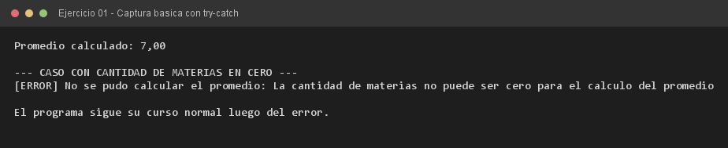

# Ejercicio 01 — CalculadorAcademico

**Objetivo:** comprender el flujo alterado por un bloque `try-catch` ante un error aritmético.
**Salida esperada:** promedio calculado y mensaje de error por `System.err` ante cero materias.

**Conceptos:** `try-catch` · `throw` · `ArithmeticException` · `System.err` · flujo de ejecución



```bash
javac -encoding UTF-8 -d bin -sourcepath src src/ejercitacion4_1/ejercicio01/CalculadorAcademico.java
java -cp bin ejercitacion4_1.ejercicio01.CalculadorAcademico
```
