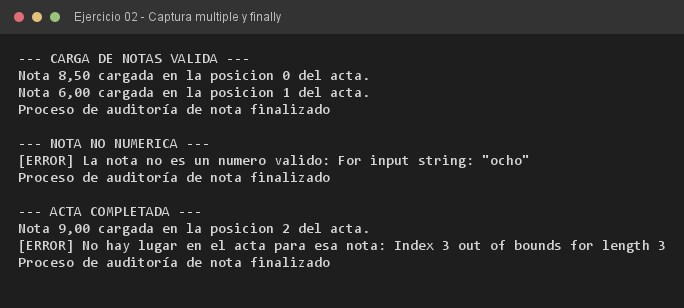

# Ejercicio 02 — CargaNotasExamen

**Objetivo:** manejar múltiples tipos de excepción de forma diferenciada y garantizar el cierre con `finally`.
**Salida esperada:** carga de notas, errores por tipo de excepción y la línea de auditoría final.

**Conceptos:** `catch` específico · `finally` · `NumberFormatException` · `ArrayIndexOutOfBoundsException`



```bash
javac -encoding UTF-8 -d bin -sourcepath src src/ejercitacion4_1/ejercicio02/CargaNotasExamen.java
java -cp bin ejercitacion4_1.ejercicio02.CargaNotasExamen
```
