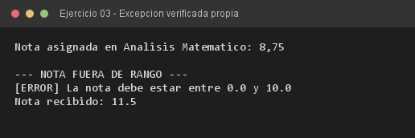

# Ejercicio 03 — Evaluacion y NotaInvalidaException

**Objetivo:** diseñar una excepción verificada propia para representar una violación de regla de negocio.
**Salida esperada:** nota asignada y error por nota fuera del rango `[0.0, 10.0]`.

**Conceptos:** excepción verificada · `extends Exception` · `throws` · captura obligatoria



```bash
javac -encoding UTF-8 -d bin -sourcepath src src/ejercitacion4_1/ejercicio03/Evaluacion.java
java -cp bin ejercitacion4_1.ejercicio03.Evaluacion
```
