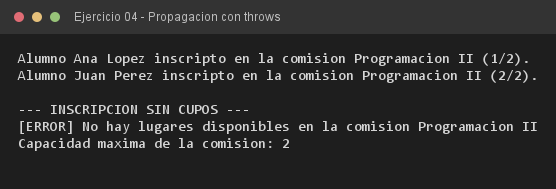

# Ejercicio 04 — Comision y CupoAgotadoException

**Objetivo:** analizar la propagación de la excepción por la pila de llamadas con `throws`.
**Salida esperada:** dos inscripciones correctas y el error atrapado en la capa cliente.

**Conceptos:** stack unwinding · propagación · método privado que lanza · capa cliente



```bash
javac -encoding UTF-8 -d bin -sourcepath src src/ejercitacion4_1/ejercicio04/Comision.java
java -cp bin ejercitacion4_1.ejercicio04.Comision
```
