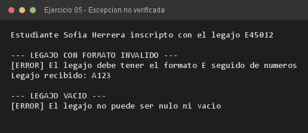

# Ejercicio 05 — Estudiante y LegajoInvalidoException

**Objetivo:** señalar violaciones de invariantes con una excepción no verificada de `RuntimeException`.
**Salida esperada:** alta de un estudiante válido y errores por legajo con formato incorrecto o vacío.

**Conceptos:** excepción no verificada · `extends RuntimeException` · validación defensiva · regex



```bash
javac -encoding UTF-8 -d bin -sourcepath src src/ejercitacion4_1/ejercicio05/Estudiante.java
java -cp bin ejercitacion4_1.ejercicio05.Estudiante
```
