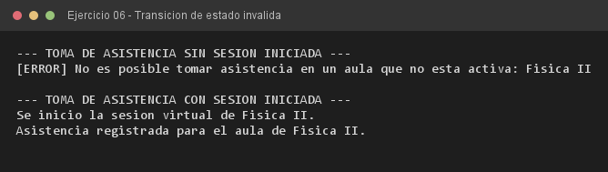

# Ejercicio 06 — AulaVirtual y EstadoAulaInvalidoException

**Objetivo:** proteger el estado operativo lanzando una excepción ante una operación no permitida.
**Salida esperada:** error al tomar asistencia sin sesión y registro correcto con la sesión iniciada.

**Conceptos:** transición de estado · excepción verificada propia · estado interno · `throws`



```bash
javac -encoding UTF-8 -d bin -sourcepath src src/ejercitacion4_1/ejercicio06/AulaVirtual.java
java -cp bin ejercitacion4_1.ejercicio06.AulaVirtual
```
