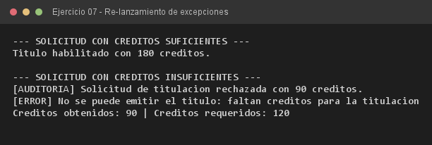

# Ejercicio 07 — SistemaTitulacion

**Objetivo:** capturar, auditar y volver a lanzar la misma excepción hacia la capa superior.
**Salida esperada:** bitácora de auditoría y mensaje final de la excepción re-lanzada.

**Conceptos:** re-throw · `throw e;` · capa intermedia · creditos de titulación



```bash
javac -encoding UTF-8 -d bin -sourcepath src src/ejercitacion4_1/ejercicio07/VerificadorTitulacion.java
java -cp bin ejercitacion4_1.ejercicio07.VerificadorTitulacion
```
