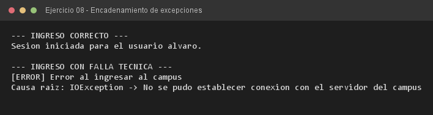

# Ejercicio 08 — AccesoCampusVirtual

**Objetivo:** encadenar una excepción de bajo nivel dentro de una de alto nivel preservando la causa raíz.
**Salida esperada:** ingreso correcto y, ante la falla técnica, el detalle de la causa raíz.

**Conceptos:** exception wrapping · `getCause()` · `IOException` · causa raíz



```bash
javac -encoding UTF-8 -d bin -sourcepath src src/ejercitacion4_1/ejercicio08/AccesoCampusVirtual.java
java -cp bin ejercitacion4_1.ejercicio08.AccesoCampusVirtual
```
