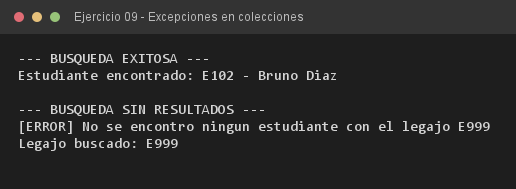

# Ejercicio 09 — RegistroUniversidad

**Objetivo:** validar la coherencia de datos al buscar elementos en estructuras dinámicas.
**Salida esperada:** estudiante encontrado en la búsqueda exitosa y excepción en la búsqueda fallida.

**Conceptos:** `ArrayList<Estudiante>` · excepción verificada propia · búsqueda lineal · for-each



```bash
javac -encoding UTF-8 -d bin -sourcepath src src/ejercitacion4_1/ejercicio09/RegistroUniversidad.java
java -cp bin ejercitacion4_1.ejercicio09.RegistroUniversidad
```
