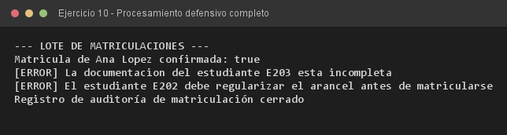

# Ejercicio 10 — ProcesadorMatricula

**Objetivo:** integrar excepciones verificadas y no verificadas, captura múltiple y limpieza garantizada.
**Salida esperada:** confirmación de matrícula, dos rechazos y la línea de auditoría siempre impresa.

**Conceptos:** excepción verificada + no verificada · captura múltiple · `finally` · validación de invariantes



```bash
javac -encoding UTF-8 -d bin -sourcepath src src/ejercitacion4_1/ejercicio10/ProcesadorMatricula.java
java -cp bin ejercitacion4_1.ejercicio10.ProcesadorMatricula
```
